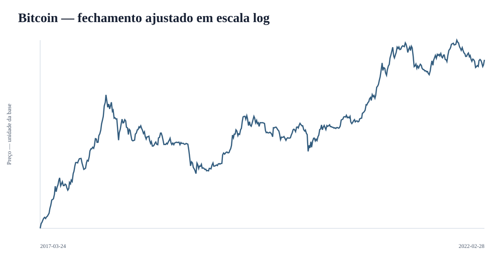
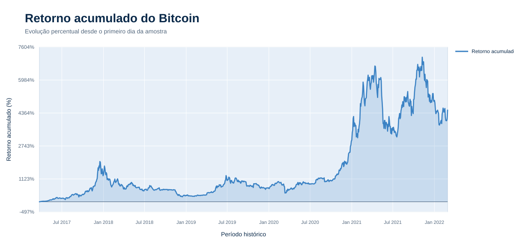
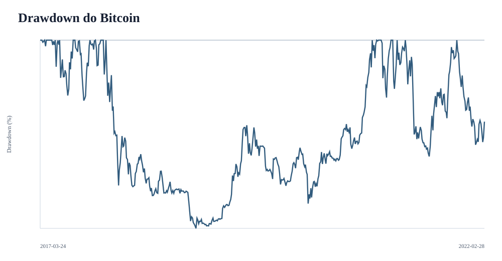
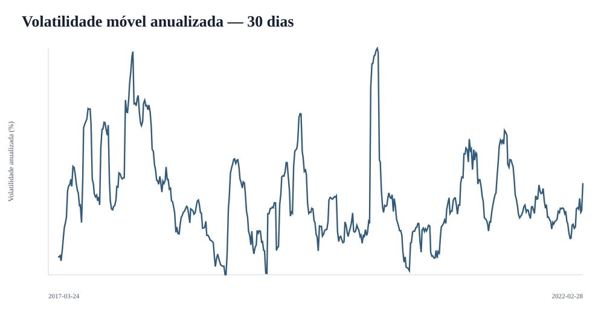
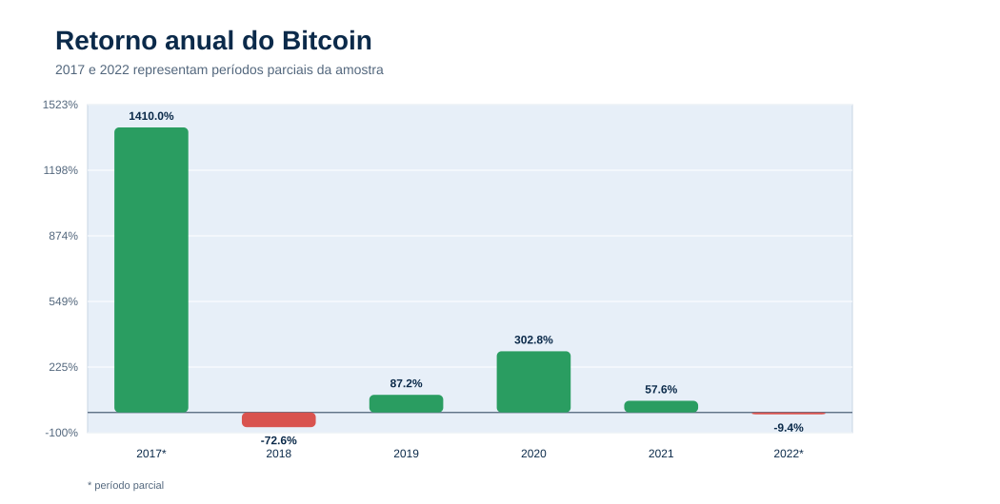
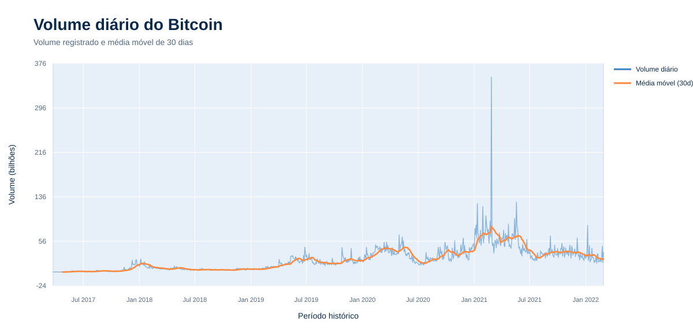
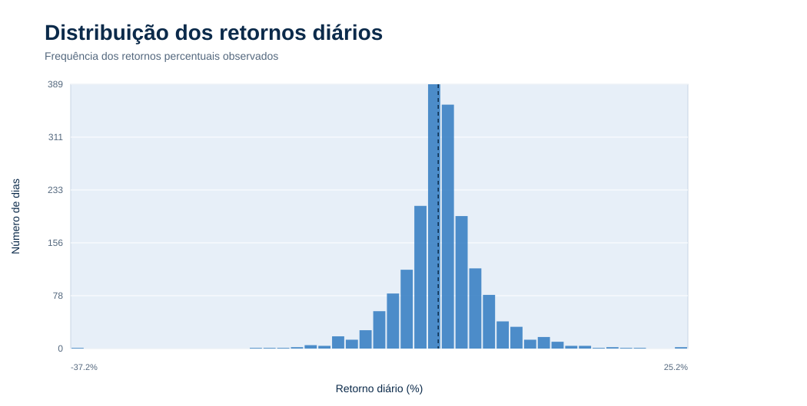

# Bitcoin Market Analysis — Retorno, Volatilidade e Drawdown com Python

Projeto de portfólio em **Análise de Dados aplicada ao Mercado Financeiro** que investiga preço, retorno, volatilidade, volume e risco de queda do Bitcoin entre março de 2017 e fevereiro de 2022.

## Pergunta central

**Como preço, retorno, volatilidade, volume e risco de queda do Bitcoin evoluíram entre março de 2017 e fevereiro de 2022?**

A análise é histórica e descritiva. **Não constitui recomendação de investimento.**

## Dataset

A base contém **1.803 observações diárias**, de **24/03/2017 a 28/02/2022**, com 1.803 dias consecutivos, sem lacunas de calendário, valores ausentes ou datas duplicadas.

Campos: `Date`, `High`, `Low`, `Open`, `Close`, `Volume` e `Adj Close`.

> O arquivo de exercício não documenta formalmente exchange, moeda ou origem da série. O projeto preserva os valores fornecidos e não atribui uma fonte externa como origem metodológica.

## Principais indicadores

- Preço inicial: **937.52**
- Preço final: **43193.23**
- Retorno acumulado: **4507.18%**
- CAGR: **117.35% ao ano**
- Volatilidade anualizada: **79.80%**
- Drawdown máximo: **-83.40%**
- Máximo da série: **67566.83** em **2021-11-08**
- Melhor dia: **25.25%** em **2017-12-07**
- Pior dia: **-37.17%** em **2020-03-12**

## 1. Preço e ciclos de mercado

A escala logarítmica facilita a leitura de uma série que muda de ordem de grandeza ao longo do período.



## 2. Retorno acumulado



O retorno acumulado supera **4.500%**, mas o resultado agregado não mostra sozinho o risco enfrentado ao longo da trajetória.

## 3. Drawdown



O maior drawdown é de aproximadamente **-83.40%**, entre o pico de **2017-12-16** e o fundo de **2018-12-15**.

## 4. Volatilidade

Como Bitcoin negocia todos os dias, a volatilidade diária é anualizada com **√365**.



## 5. Retorno por ano da amostra



| Ano | Retorno | Volatilidade anualizada |
|---|---:|---:|
| 2017 (parcial) | 1409.98% | 98.67% |
| 2018 | -72.60% | 81.06% |
| 2019 | 87.16% | 68.06% |
| 2020 | 302.79% | 72.04% |
| 2021 | 57.64% | 80.41% |
| 2022 (parcial) | -9.42% | 70.72% |

> **2017 e 2022 são períodos parciais.** A amostra começa em março de 2017 e termina em fevereiro de 2022.

## 6. Volume



## 7. Distribuição dos retornos diários



## Principais achados

1. O Bitcoin apresenta forte valorização acumulada na amostra, acompanhada de risco elevado.
2. O drawdown máximo supera **80%**.
3. A volatilidade anualizada fica próxima de **80%**.
4. O pior dia da série ocorre em **12/03/2020**, com queda de aproximadamente **37,17%**.
5. O maior preço ajustado da amostra ocorre em **08/11/2021**.
6. O comportamento varia fortemente entre anos, evidenciando ciclos de alta e correções profundas.
7. A análise não atribui causalmente os movimentos de preço a notícias ou fatores macroeconômicos.

## Estrutura do projeto

```text
bitcoin-market-risk-analysis/
├── .github/workflows/python-tests.yml
├── data/
│   ├── raw/bitcoin_daily_2017_2022.csv
│   └── README.md
├── notebooks/bitcoin_market_analysis.ipynb
├── reports/
│   ├── figures/
│   ├── methodology.md
│   └── summary.json
├── src/
│   ├── analysis.py
│   └── metrics.py
├── tests/test_metrics.py
├── pytest.ini
├── requirements.txt
├── LICENSE
└── README.md
```

## Como executar

```bash
python -m venv .venv
pip install -r requirements.txt
python -m src.analysis
```

## Testes

```bash
pytest -q
```

## Tecnologias

Python · Pandas · NumPy · Matplotlib · Jupyter Notebook · Pytest · GitHub Actions

## Limitações

- a série termina em fevereiro de 2022;
- 2017 e 2022 são anos parciais;
- não há benchmark;
- não há dados macroeconômicos ou fundamentalistas;
- a origem/exchange não está documentada no arquivo de exercício;
- a análise é descritiva e não constitui recomendação de investimento.

## Autor

**Pablo Sena**  
GitHub: [@pablosena28](https://github.com/pablosena28)
